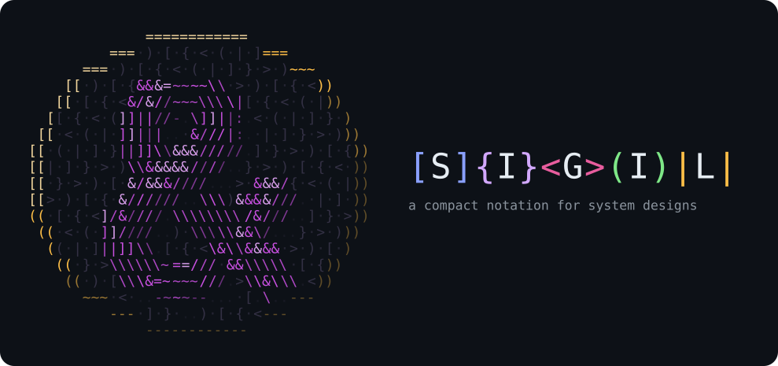

# Sigil

<p align="center"></p>

A notation for system designs, written with your coding agent.

Sigil describes how a system is wired: its components, data, events, actors and
stores, and the calls, events and failures between them, in a few lines of text. Its
tools lint a design, flag the risks it leaves unhandled, draw it in the terminal and
step through its paths. The plugin teaches your coding agent to read and write it.

A URL shortener ([`shortener.sigil`](https://no-tably.github.io/sigil/examples/shortener.sigil)):

```sigil
#!sketch

--- URL shortener ---
(User) -> [Shortener] : shorten({Url}) => {Code}
[Shortener] -> |Links| : save({Code}, {Url})
(Visitor) -> [Redirect] : follow({Code})
[Redirect] -> |Links| : lookup({Code}) => {Url}
           !> (Visitor) : <NotFound>
           -> (Visitor) : redirect({Url})
           ~> <Clicked> -> [Stats]
```

Line by line:

- `(User) -> [Shortener] : shorten({Url}) => {Code}`: a user sends a URL, gets a code.
- `[Shortener] -> |Links| : save({Code}, {Url})`: the pair is stored.
- `(Visitor) -> [Redirect] : follow({Code})`: a visitor follows a code.
- `[Redirect] -> |Links| : lookup({Code}) => {Url}`: it's looked up.
- `!> (Visitor) : <NotFound>`: missing: not found.
- `-> (Visitor) : redirect({Url})`: found: redirected.
- `~> <Clicked> -> [Stats]`: each click, async, to stats.

A line that starts with an arrow continues from the subject above.

`sigil view` draws it in the terminal, as a call graph read left to right (the flow
view, its default):

```
── URL shortener ───────────────────────────────────────

    (User) ─────▶ [Shortener] ─┬─▶ |Links|
╭─✖┐(Visitor) ──▶ [Redirect] ──┼╌▶ <Clicked> ──▶ [Stats]
├─▶┘                           │
╰──────────────────────────────╯

shortener.sigil: 7 nodes, 8 edges, 0 expansions · #!sketch
lint: OK
```

`--graph` draws the same design as boxes and edges, top down (`t` steps through
the graph, tree, flow and run views live):

```
── URL shortener ──────────────────

  ╭────────╮       ╭───────────╮
  │ (User) │       │ (Visitor) │
  ╰────────╯       ╰───────────╯
       │                    ▲ ✖
       │                    │ │
       ▼                    │ ▼
┌─────────────┐   ┌────────────┐
│ [Shortener] │   │ [Redirect] │
└─────────────┘   └────────────┘
         │               │
         │       ┌───────┤
         ▼       ▼       ▼
        ┌─────────┐   ┌───────────┐
        │ |Links| │   │ <Clicked> │
        └─────────┘   └───────────┘
                           │
                           ▼
                      ┌─────────┐
                      │ [Stats] │
                      └─────────┘
```

`--sim all` runs both of its paths — the happy one, and a lookup that fails — and
one run where the two entries overlap (`Visitor@0`, see
[Runs that overlap](#runs-that-overlap)):

```sh
sigil view shortener.sigil --once --sim all
```

```
happy                    ok       47 frames  every default: the happy path
Redirect.lookup:fails    failed   32 frames  lookup fails 1×, no fallback
  failed: [Redirect] -> |Links| · (Visitor) -> [Redirect]
  routes: [Redirect] !> (Visitor)
Visitor@0                ok       31 frames
    (Visitor) starts at t0, reaching |Links| as [Shortener] writes it
3 scenarios: 2 ok, 1 failed, 0 cut
```

**Try it:** the [project page](https://no-tably.github.io/sigil/) has a
[playground](https://no-tably.github.io/sigil/#playground) that runs these tools in
the browser — write a design, switch views, step through a simulation.

- **Spec:** [`language.md`](./language.md) — glyphs, arrows, modifiers, payloads,
  control-flow blocks, streams, zoom, composition trees (`\-` branches with the
  relations `> & ? $ @ ! = _` and qualified paths like `[Bullet]/{Transform}`),
  modes, normal form, grammar.
- **Design records:** [`rfcs/`](./rfcs/README.md) — accepted RFCs with their decisions.
- **Examples:** [`examples.md`](./examples.md) — worked prose ↔ Sigil pairs.

## Tools

One command, `sigil`, Python 3 standard library only: run `bin/sigil` (or
`python3 -m sigil` from the repository). `lint`, `check`, `export --mermaid` and
`highlight` take `-` for stdin; `view` needs a file, since it redraws on save, and so does the
folder export, since the manifest names the spec file. `sigil --version` prints the
version. Every flag and key is in [`docs/tools.md`](./docs/tools.md).

| Command | Does |
| --- | --- |
| `sigil view FILE` | Live terminal view, redrawn on every save: a flow view (a call graph left to right, the default), a graph view (`--graph`), a tree view (`--tree`) and a run view (one simulated run as a timeline, `--run`) — `1` `2` `3` `4` pick one, `t` steps to the next — a simulation mode (`x`) and a checks overlay (`c`). `--once` prints one drawing for agents and CI. `--structure` prints no drawing but the design read as units: each unit's members and dependencies, cycles between units, each part's reach, units over 9 members, writers per store. |
| `sigil lint FILE` | Validates a document: one `severity:line:rule: message` per issue; exit 0 clean, 1 warnings, 2 errors. `--deep` adds the composition checks. |
| `sigil check FILE` | Composition checks ([RFC 0003](./rfcs/0003-composition-checks.md)): does the design say how its risks are handled — time bounds, idempotency, writers, failure routes, stuck state machines, units that depend on each other or grow too big? A finding never forbids a shape: declare the handling, or accept the risk with a reason. |
| `sigil export SPEC --out DIR` | Exports a ready `#!spec` document as a build skeleton: a folder per system, a file per component, `manifest.json` as the contract. A re-export says which systems changed (see [Export a spec](#export-a-spec)). |
| `sigil export FILE --mermaid` | Emits a Mermaid `flowchart TD` for docs or review (GitHub, Obsidian, mermaid.live), in any mode. `--spine` groups it by the export's systems, a subgraph each. |
| `sigil themes [NAME]` | Prints a colour theme from `themes/*.yaml` resolved, as JSON (`--list` lists them); the viewer and the web page share the files. |
| `sigil highlight FILE` | Prints the source in the theme's colours, as the drawings colour it (see [Highlight a file](#highlight-a-file)); `--json` gives the coloured runs to a host, `--stream` serves a live editor. |
| `--dialect NAME` | `lint`, `check`, `view`, `export` and `highlight` load a dialect that extends the linter, Mermaid and checker. |
| `highlight/` | Syntax highlighting for bat, nvim, VS Code, Sublime/TextMate, checked against `sigil highlight`. |

## Install as an agent skill

Sigil ships as a skill (`sigil`) plus two commands (`sigil-view`, `sigil-lint`)
for several coding agents. Each GitHub release attaches one archive per agent,
`sigil-<agent>-<version>.zip` (and `.tar.gz`), plus
`sigil-{claude,codex}-marketplace-<version>` archives. Build them locally with
`./build.py` (see [Development](#development)).

### Claude Code

```sh
# from a release: unzip sigil-claude-marketplace-<version>.zip, then in Claude Code
/plugin marketplace add ./sigil-claude-marketplace-<version>
/plugin install sigil@sigil
# or try it for one session without installing
claude --plugin-dir ./sigil-claude-<version>
```

The plugin needs Claude Code 2.1.281 or later (`claude update`): older versions
refuse its settings (`Unrecognized key: "options"`, before 2.1.260) or its viewer mod.

Commands appear as `/sigil:sigil-view <file>` and `/sigil:sigil-lint <file>`.

The Claude Code plugin also carries a viewer mod. The agent gets a `view` tool
that shows a design to you while you design it together: the graph, tree, flow or
run view, redrawn on every save, and a simulated run stepped or played. Where it draws
is the plugin's `display` option:

- `mod` draws in a pane beside the conversation, in the theme's colours. A pane
  you didn't ask for needs a terminal at least 144 columns wide. When it's
  narrower, the agent's reply says the pane is waiting. `/sigil-pane [FILE]` opens
  it at any width.
- `multiplex` opens a herdr, tmux or zellij split that runs `sigil view` live, and
  the agent's later calls update it. Nothing draws in Claude Code. With the
  `placement` option set to `tab` (`/sigil-pane placement tab`), it opens a tab
  (a tmux window) labelled `sigil view` instead of a split.
- `auto` (the default) picks `multiplex` when `HERDR_ENV`, `TMUX` or `ZELLIJ` is
  set, and `mod` otherwise.

Set it with `/sigil-pane display mod|multiplex|auto` (`/sigil-pane display`
says what it is now and what `auto` picks here), in `/config`, or under
`pluginConfigs` in settings.

### Codex

Unzip `sigil-codex-marketplace-<version>.zip` and add it as a local plugin
marketplace (it holds `.agents/plugins/marketplace.json` → `./plugins/sigil`), or
copy the skills straight into a skills directory:

```sh
unzip sigil-codex-<version>.zip
cp -R sigil-codex-<version>/skills/* ~/.agents/skills/     # or <repo>/.agents/skills/
```

The commands become explicit-only skills: invoke them as `$sigil-view` /
`$sigil-lint`.

### pi

```sh
unzip sigil-pi-<version>.zip
pi install ./sigil-pi-<version>        # add -l to install for this project only
```

Provides the `sigil` skill and the `/sigil-view` and `/sigil-lint` prompts.

The pi package also carries a viewer extension, which works like the Claude Code
mod. The agent gets a `sigil_view` tool, and you get a `/sigil-pane` command. With
`mod` display it draws in a widget above the editor, and a widget you didn't ask
for needs 144 columns. With `multiplex` it opens a herdr, tmux or zellij split, or
a tab with `/sigil-pane placement tab` (`--sigil-placement`, `SIGIL_PLACEMENT`).
`auto` picks between them the same way. Choose with `/sigil-pane display
mod|multiplex|auto`, which saves it to `~/.config/sigil/viewer.json`; for one
session, `pi --sigil-display …` or `SIGIL_DISPLAY` wins over that.

### OpenCode

```sh
unzip sigil-opencode-<version>.zip
./sigil-opencode-<version>/install.sh                   # ~/.config/opencode
./sigil-opencode-<version>/install.sh --project .       # ./.opencode
```

Provides the `sigil` skill and the `/sigil-view` and `/sigil-lint` commands.
(OpenCode also discovers skills in `~/.claude/skills` and `.agents/skills`.)

OpenCode gets no viewer plugin. To watch a design live, run `sigil view FILE` in a
herdr, tmux or zellij split; the agent reads `sigil view FILE --once`.
[`docs/tools.md`](./docs/tools.md#opencode) says why.

## Simulation

Sigil does not execute, but the viewer can *walk* a design: its simulator reads it as
tokens moving along its flows, so you can watch the happy path, each failure
route, each branch arm, race and alternative play out over the same drawing — in
the graph view and the tree view alike. No values are computed and nothing is
random; the run is a function of the design and the chosen **scenario**.

- **Scenarios** are the design's pathways, each with a stable name: `happy` (every
  default: calls succeed, `?>` not taken, the first member of a race / alternative /
  branch wins), then one per deviation — `API.charge:fails` (an op call fails:
  `Caller.verb:fails`, or `:fallback` when it falls back), `API->Payments:fails` (a
  plain call with `×N` / `@timeout` / `@fallback` / a `!>` route fails),
  `Risk?>Review` (a conditional taken), `Payments:fails` (a node with a `!>` route
  fails), `Api&?PspB` (another race winner), `Api/Err` (another alternative), a
  branch arm, … Join two with `a+b`. After them come a few **overlap** scenarios,
  `Entry@t` (see [Runs that overlap](#runs-that-overlap)), then the **state
  starts**, `Owner=State`: a state machine begun in a later state (`Order=Shipped`,
  any state its block names), so a way out of that state is walked; one is listed
  per state, other than the initial one, that a transition leaves. An unknown name
  prints the known ones (exit 2).
- **What moves:** `->` calls wait for their return, `~>` forks without waiting,
  `*>` and `&` fork to all and wait for all, `!>` fires only on failure, retries
  count their attempts, events drive the state machines that name them (each
  machine's current state is marked `◉`), loops and recursion are bounded.
  Every run ends: one that would not is `cut` at a limit (frames and activations
  per episode, which grow with the design's size), and the run says which episode
  hit it. In `#!spec`, `sigil check` warns about a cut run, so it blocks the export
  until the limit is raised or the cut is acknowledged. A design that needs longer
  runs says so on its `#%` line (`#% frames=300000`), so every command runs it
  there; `--limit frames=N` sets one for a single run, over the document's own.
- **Levels:** an expansion is a closer reading of its node, so an outer flow whose
  target the expansion also reaches by a flow (not only by a failure route or
  an optional `?>`) is a summary of that detail — `[Shop] ~>
  <OrderPlaced>` over `[Checkout] ~> <OrderPlaced>` inside `[Shop] := { … }` — and
  runs once, as the detail (the summary lights with it).
- **The marks:** `●` a token going out, `○` a return or fallback, `✕` a failure (in
  the failure colour), `⊘` cancelled; the wire a token is on now bright, the wires
  taken before faded, the ones never taken fainter; `…` waiting, `×n`
  spawned instances, `↻k` recursion depth.
- **In words:** every step of a run reads as a sentence — `[API] calls [Payments]
  with charge(total) — attempt 2 of 4`, `|Orders| returns {Order} to [API]`,
  `[Checkout] moves Idle → Busy on <Placed>`.

Live, `x` enters sim mode in any of the four views. Space plays and pauses, `,` /
`.` step a frame, `<` / `>` step to the previous / next event, `[` / `]` pick the
scenario (named in the status bar), and `-` / `+` set the speed (¼ to 32 frames a
second, starting at 2). Under the drawing, `path` writes the episode's hops so far
in notation, numbered by branch — `① (Shopper) -> [API] -> [Payments] ✖×4   ② [API]
!> <PaymentFailed>`, `✖` a failed hop, `⊘` a cancelled one, the hop a token is on
now in bold — then come the last few events and the narration line (`›`, what is
happening now). The view follows the run as it moves; `w` turns that off. For agents
and CI, `--once --sim SCENARIO` prints the run's last frame (or `--frame N`'s), the outcome, its path
and the run in words (here
[`examples/checkout.sigil`](https://no-tably.github.io/sigil/examples/checkout.sigil)
with its card charge failing; legend and lint summary left out):

```sh
sigil view checkout.sigil --once --tree --sim 'API.charge:fails'
```

```
── checkout ──────────────────────────────
  (Shopper) ✕ ───────────────●
  [API] ✕ ◀──────────────────┴═●═✖═●═›═›═›
  [Payments] ✕ ◀───────────────┘ │ │ ║ ║ ║
  <PaymentFailed> ◀──────────────┘ │ ║ ║ ║
  |Orders| ◀───────────────────────┘ ║ ║ ║
  [Email] <OrderPlaced> ◀════════════╝ ║ ║
  [Shipping] <OrderPlaced> ◀═══════════╝ ║
  |Ledger| <OrderPlaced> ◀═══════════════╝

sim API.charge:fails (charge fails 4×, no fallback): failed · 31 frames
path   ① (Shopper) -> [API] -> [Payments] ✖×4   ② [API] !> <PaymentFailed>
t000 conventions: written order; entries one after another; ?> not taken by default; the first member wins a race / alternative / branch
t000 episode 1 begins at (Shopper); (Shopper) calls [API] with {Cart}
t005 [API] calls [Payments] with charge(total) — attempt 1 of 4
t009 charge(total) to [Payments] fails — attempt 1 of 4
t010 [API] calls [Payments] with charge(total) — attempt 2 of 4
t014 charge(total) to [Payments] fails — attempt 2 of 4
t015 [API] calls [Payments] with charge(total) — attempt 3 of 4
t019 charge(total) to [Payments] fails — attempt 3 of 4
t020 [API] calls [Payments] with charge(total) — attempt 4 of 4
t024 charge(total) to [Payments] fails — attempt 4 of 4
t025 [API]'s call to [Payments] fails after 4 attempts; [API] routes the failure to <PaymentFailed>
t030 (Shopper)'s call to [API] fails — its callee failed; episode 1 fails; the run ends: failed
```

The run view (`--run`, `4` live) draws the same run as a timeline: a lane per
participant (per instance, per recursion level), time left to right, a bar per
activation (`█` working, `░` waiting), each call drawn at its send tick, each
retry a repeated segment, and a note per lane in plain words. Without `--sim` it
draws the happy run.

```sh
sigil view checkout.sigil --once --run --sim 'API.charge:fails'
```

```
── run · API.charge:fails — charge fails 4×, no fallback ───────────────────────────────────────────

                  0         10        20        30
  (Shopper)       █░░░░░░░░░░░░░░░░░░░░░░░░░░░░░✕   episode 1's entry; calls [API]; fails
  [API]           ╰──▶██░░░░█░░░░█░░░░█░░░░█░░░░✕   calls [Payments]; routes the failure; fails
  [Payments]           ╰───✖╰───✖╰───✖╰───✖│        4 attempts, each fails
  <PaymentFailed>                          ╰──✖◆    lands
```

An agent designing with you runs every scenario at once: `--sim all` prints, with no
drawing, a line per run (name, outcome, frames, label) and the facts that judge it
(each state machine's end state, what failed, the routes taken, any bound hit), then
a summary. Diff two versions' tables to see what a change did to the design's
behaviour; `--sim list` lists the scenarios and `--json` prints either as JSON
(`--sim NAME --json`: one run's facts, its steps in words and its raw log).

```sh
sigil view orders.sigil --once --sim all
```

```
happy                    ok       32 frames  every default: the happy path
  states: [Checkout] Idle · {Order} Settled
Payments:fails           failed   32 frames  Payments fails → Declined
  states: [Checkout] Idle · {Order} Cancelled
  failed: [Payments]
  routes: [Payments] !> <Declined>
Payments@0               ok       21 frames
    [Payments] starts at t0, reaching {Order} while (Shopper) is there
  states: [Checkout] Busy · {Order} Open
  ignored: <Paid> in {Order} + · <Paid> in [Checkout] Idle
Payments@10              ok       21 frames
    [Payments] starts at t10, reaching [Checkout] as (Shopper) changes its state
  states: [Checkout] Idle · {Order} Settled
Checkout=Busy            ok       32 frames  starts with [Checkout] in Busy
  states: [Checkout] Idle · {Order} Settled
  replayed: <Placed> in [Checkout] Busy
Order=Open               ok       32 frames  starts with {Order} in Open
  states: [Checkout] Idle · {Order} Settled
  replayed: <Placed> in {Order} Open
6 scenarios: 5 ok, 1 failed, 0 cut
```

### Runs that overlap

A run plays its entries one after another: the next entry's episode starts the tick
after the one before it went quiet. A scenario can instead start an entry at a tick
of its own — `Author@25` starts `(Author)`'s episode at tick 25 while the earlier
ones still run — so two things can happen at once from two starting points. It
combines with the others: `Builder.claim:fallback+Author@25`. Running episodes take
turns in a fixed order each tick, so an overlapping run is as repeatable as any.

The scenario list ends with a few of these, chosen for you: each later entry started
so that it reaches something an earlier entry's episode is busy with (a store, a
state machine, a node, an event) just as it is — the moments a race could happen (the
`Payments@0` and `Payments@10` rows above). There are at most 3 per pair of entries
and 12 in all (`--limit pair_overlaps=N`, `--limit overlaps=N`); any other `Entry@t`
works by name. While more than one episode runs, each narrated sentence starts with
its episode, the graph, tree and flow views draw each token as its episode's number
in that episode's colour, and the run view marks where each episode starts on the
ruler and lists the episodes under the drawing. Here
[`examples/overlap.sigil`](https://no-tably.github.io/sigil/examples/overlap.sigil):
an author exports while a builder is mid-build, and the stale notice lands between
two of the builder's steps (the log from t020):

```sh
sigil view overlap.sigil --once --sim Author@25
```

```
t020 [Status] returns {System} to [Builder]
t025 ep2: episode 2 begins at (Author); ep1: [Builder] calls |Ledger| with claim({System}); ep2: (Author) calls [Exporter] with export({Spec})
t030 ep2: [Exporter] calls [Gate] with verify({Spec}); ep1: |Ledger| returns {Lease} to [Builder]
…
t045 ep1: [Status] calls |Ledger| with read({Hash}); ep2: [Exporter] emits <Stale>; ep2: [Exporter] returns {Delta} to (Author)
t050 ep2: <Stale> calls [Builder] with recheck({Delta}); ep1: [Status] returns {Verdict} to [Builder]
```

`sigil check` looks further than the list when it checks a `#!spec` document (or is
given `--overlaps all`): its behavioural rules start each later
entry at *every* tick of an earlier entry's episode (within `--budget`), so a race
between two entries — two writers from two episodes, an event landing in a state
that exists only mid-episode — is found, and its witness names the run
(`SGC204: race: … holds it too in the Bob@0 run`) for `--sim Bob@0` to replay.
This sweep is the exhaustive check before a spec is final. It stops at a work cap
(400 frames a run × the budget), so a large spec still checks in seconds; when the
cap stops it, the SGC090 hint says how many overlap runs were left. In sketch and craft it
is off, so checks stay quick while you draft; `--overlaps listed` tries just the
listed runs, and `--overlaps N` caps the sweep at N runs. A spec check also walks
the state starts (before the overlap runs, within `--budget`), so an event that
finds no transition out of a later state is found and named by its run
(`dropped in the Ticket=Done run`).

A `#%` line under the mode line says what kind of system the design is
(`#% library`, `#% daemon`, `#% job in-process deterministic`), and the checks
skip the groups of rules that kind cannot need: a library is not asked who calls
it, a daemon not what ends it, a deterministic system not about races. The summary
names every rule it skipped, and `--all-rules` runs them anyway.

## Export a spec

Once a design is final, `sigil export` hands it to whoever builds it: a folder per
system, a Markdown file per component (kind, description, interface, requirements,
lifecycle), and `manifest.json`, the contract. Systems come from the design itself,
no new syntax: each `X := { … }` expansion (a data expansion is the data's shape, not
a system), each composition-tree root, and the top
level (named after the file, or `--name NAME`; a top-level service of that name,
`[Shop]` in `shop.sigil`, is the top level itself). Only a ready spec exports: its mode
line is `#!spec`, lint finds no error, and `sigil check --export` leaves no error or
warning unacknowledged. Otherwise `sigil export` prints what blocks it, exits 2 and
writes nothing. Here the shop in
[`examples/export.sigil`](https://no-tably.github.io/sigil/examples/export.sigil),
saved as `shop.sigil`:

```sh
sigil export shop.sigil --out build
```

```
build/
  manifest.json      the sigil that wrote it; per system: interface hash, body hash, components (each with its two hashes), depends_on, parent
  delta.json         what changed since the last export (the first: every system added)
  README.md          the index: systems and what each depends on
  shop/              the top level: (Shopper), [Storefront], [Checkout], …
  catalog/           the [Catalog] tree: README.md, listings.md, prices.md, system.json
  checkout/          the [Checkout] expansion: basket.md, payments.md, orders.md, …
  fulfilment/
  warehouse/
```

Each system, and each component in it, has two hashes: the **interface** (the
flows that cross its boundary, with their payloads and returns, and the shapes of
the data they carry or its tree holds: `{Doc} := { path, text, note? }`, field names
only) and the **body** (everything in it). Reformatting, reordering or renaming the spec moves neither (a
rename moves the top system's key and folder, which `delta.json` reports as
`renamed`, with no system to rebuild, unless the new name is a top-level service's);
`system.json` also gives every component and flow its spec `lines`. Export again into the same folder after an
edit, and `sigil export` compares with the manifest already there, rewrites only what
changed and writes `delta.json`. Here `[Stock]`'s reprice call now returns a
`{Price}`:

```
since spec 42c36c489b8429a2: 2 rebuild, 1 recheck, 2 unchanged
  rebuild    Catalog (body 047fc4d040438706 → 3b41ebbe867e8651)
  rebuild    Warehouse (body 43fb9956b782789c → 12e4df86f4932dc2)
  recheck    shop (interface changed: Catalog, Warehouse)
  unchanged  Checkout, Fulfilment
```

`rebuild` systems changed inside; a `recheck` system is unchanged but depends on one
whose boundary moved, or sits inside a system that does (outside itself): its
members make that system up, so the delta names the changed system and the
enclosing one it came through (`Store (via Outer)`). `depends_on` stays the
system's own flows. `--dry-run` prints the delta and writes nothing; `--json`
prints it as JSON. Building against the export happens outside sigil.

A system keeps its folder from one export to the next: a new system whose name
slugs the same takes the next free `-2`, `-3`, and a folder that does move (the top
renamed) shows as `moved` in the delta. Folder names are at most 100 bytes (a long
one ends in a hash of the name) and never a Windows device name (`nul` → `nul-x`).
`sigil export` never writes, compares or deletes through a symbolic link inside
`--out` (it refuses, exit 2; `--out` itself may be a link). Every flag and
field is in [`docs/tools.md`](./docs/tools.md#sigil-export-spec---out-dir).

## Highlight a file

`sigil highlight FILE` prints a document's source in colour (plain under
`NO_COLOR`). It reads each line the way every other command reads it, so a glyph, an
arrow, a modifier or a mode line is coloured by what sigil takes it to be, in the
theme's colours, and half-typed text highlights too.

```sh
sigil highlight shop.sigil              # in the terminal
sigil highlight shop.sigil --json       # each line's runs: [text, role, "#rrggbb"]
sigil highlight --stream                # JSON lines in, JSON lines out, for an editor
```

An editor plugin keeps one `--stream` process: it sends the lines that changed with
the state the line above ended in, and gets back their runs and end states; the
protocol is in `sigil highlight --help` and [`docs/tools.md`](./docs/tools.md#sigil-highlight-file-).
The editor grammars in [`highlight/`](./highlight/README.md) colour instantly
without a process, and a test keeps them in step with `sigil highlight`.

## Themes

One YAML file colours both the terminal viewer and the web page:
`themes/sigil.yaml` (the default) holds a `palette` of named colours and the roles
built from it — `kinds` (box colours by glyph; `kinds.service` colours
`[component]` glyphs), `edges`, `syntax` (code highlighting), `ui` (viewer
chrome), `run` (a colour per episode, for runs that overlap) and `site`. A value
`$name` refers to `palette.name`, so a role follows its palette colour; a new theme can start with `extends: sigil` and override
only what it changes. Drop it in `themes/` or a directory on `SIGIL_THEME_PATH`;
`sigil themes NAME` prints it resolved and `sigil themes --list` lists what it finds.
`view`, `frames draw` and `highlight` colour with `--theme NAME` if given, else
`SIGIL_THEME`, else the loaded dialect's own theme (its `THEME`), else `sigil`.
The format is a small YAML subset (nested maps, scalars, `#` comments) that
the viewer's theme loader and the page both parse without a YAML library. A theme
is a regular file of at most 1 MiB, nested at most 16 deep, with an `extends` chain
of at most 16; `sigil themes` warns about a colour that is not `#rrggbb` / `#rgb`
or a role the viewer does not know.

## Web page

`site/` is a static page: an explainer, a live editor that types the examples in
`site/examples/` line by line while the viewer's four views redraw on planes in a 3D
background, a strip of short sections that brings each plane forward in turn (the
run view playing the URL shortener's happy and failing runs), the skill, and install
commands. `site/build_site.py` renders every typing step and those runs through
the viewer into `frames.json` and turns the theme YAML into CSS variables;
`.github/workflows/pages.yml` publishes it with GitHub Pages.

The **playground** runs the tools themselves in the browser: the build copies
the `sigil/` package (less the export layer: `sigil/publish/` and the export
model and rules) into `py/` byte for byte, and
[Pyodide](https://pyodide.org) runs it when a visitor presses *start*
(`site/playground.py` is the thin JSON layer the page calls). Write a design, switch
views (graph, tree, flow, run — `1` `2` `3` `4` or `t` on the drawing, as in the viewer), read
the lint, pick a scenario (the overlap runs grouped under "overlaps") and step
through its run, a frame or an event at a time, with the viewer's path and
narration line under the drawing; *share* puts the
document in the link. Nothing about the notation is re-implemented in JavaScript, so
the page cannot drift from the CLI (`tests/test_site.py` checks the copies and that
the playground draws what `sigil view` draws).

```sh
python3 site/build_site.py --out _site && python3 -m http.server -d _site 8000
```

`?theme=NAME` previews another theme from `themes/`.

## Dialects

Plain Sigil is domain-neutral. A **dialect** layers extra vocabulary on top —
additional modifiers, lint passes and render rules — without changing the core
language. Dialects are Python modules loaded by the core (`sigil/core/dialects.py`) from a path or
from directories on `SIGIL_DIALECT_PATH`; select one with `--dialect NAME` or
`SIGIL_DIALECT=NAME`. A bare name (no `/`, not ending in `.py`) is a name only,
never a folder in the working directory; give a path (`./foo`, `foo/dialect.py`)
to load a file. For example, `sigil-merlang` (maintained separately) adds a
component type system and UI-layout vocabulary for one agent runtime. A dialect
imports the core's vocabulary from `sigil.core.vocab` (the dialect API), hooks the
one reading of a document every tool shares (`prepasses`, `strips`, `tokenizers`;
see [`docs/tools.md`](./docs/tools.md#dialects)), and a dialect's own command calls
`sigil.cli.main(argv, dialect=NAME)`. See "Dialects" in
[`language.md`](./language.md) for the extension API.

## Development

```sh
python3 -m unittest discover tests          # all tests
./build.py                                   # build every target into dist/
./build.py --target claude --version 1.2.3   # one target, explicit version
./build.py --check                           # validate dist/ (CI runs this)
cd plugin/pi && bun install --frozen-lockfile && bun run typecheck   # type-check the pi extension
```

### Layout

The tools are one package, `sigil/`, run through one command, `bin/sigil` (or
`python3 -m sigil`). Its layers are the expansions of
[`design/sigil.sigil`](./design/sigil.sigil), the toolchain drawn in Sigil, and a
layer imports only the layers above it (`tests/test_spine.py` checks every import):

```text
bin/sigil        the command (puts the package on the path, calls sigil.cli)
sigil/cli.py     one entry point: lint · check · view · export · frames ·
                 themes · highlight; each subcommand imports its layers only
                 when it runs
sigil/core/      the notation read: lex (the lexical tables, kept once),     ┐
                 tokens · statements · parse (a document → the graph model), │ core
                 graph, comments, dialects, vocab (the dialect API)          ┘
sigil/model/     scene (wires, roles, colours, notes, joins),                ┐ model
                 sim/ (program · engine · scenarios · narration), systems,   │
                 structure (the design read as units, view --structure)      ┘
sigil/analyse/   lint/ (SGLnnn, by rule group), check (SGCnnn: registry,     ┐ analyse
                 findings, acks, budget), rules/ (flow · state · trace ·     │
                 inv · structure · export)                                   ┘
sigil/publish/   mermaid, spine (--mermaid --spine), systems, exporter,      ┐ publish
                 delta: what leaves sigil                                    ┘
sigil/present/   app (the terminal viewer), views/ (graph · tree · flow ·    ┐ present
                 run), kit, themes, frames (packed rows for the hosts),      │
                 highlight (the source as coloured runs)                     ┘
themes/          YAML themes, shared with the page
build.py         packaging (maintainers only)
site/  the page and playground · tools/  goldens, doc regeneration, snapshot
docs/  the tools reference, viewer coverage audit · rfcs/  design records
design/  sigil drawn in sigil · tests/  unit tests, fixtures and goldens
highlight/  editor grammars (checked against sigil highlight)
```

`core ← model ← analyse ← publish / present ← cli`: publish and present never
import each other, and `sigil lint` loads neither the checker, the model nor the
drawings. `build.py` ships the whole package; the page's playground loads the
same files (less the export layer).

Canonical packaging sources — edit these, never `dist/`:

- `skills/sigil/SKILL.md` — the skill, with spec-only frontmatter and paths
  relative to the skill (`scripts/…`, `references/…`).
- `plugin/meta.json` — name, version, description, author, keywords.
- `plugin/commands/*.md` — commands, using `$1` / `$ARGUMENTS` and the
  `@SCRIPTS@` placeholder for the skill's scripts directory.
- `plugin/claude/` — the Claude Code viewer mod: `hooks/` (the TypeScript hooks
  module), `types/` and its own `tests/`; its Python half is the package's
  `sigil frames`
  (`claude plugin test plugin/claude`). See [`plugin/claude/README.md`](plugin/claude/README.md).
- `plugin/pi/` — the pi viewer extension: `extensions/sigil/index.ts`, which shares
  the mod's `hooks/logic.ts`. See [`plugin/pi/README.md`](plugin/pi/README.md).

`build.py` copies the `sigil/` package, `bin/sigil` and `themes/*.yaml` into
`skills/sigil/scripts/` (the skill runs `scripts/bin/sigil`) and `language.md` / `examples.md` into
`skills/sigil/references/`, then writes each agent's manifests. Archives are
deterministic. CI (`.github/workflows/ci.yml`) tests, type-checks the pi extension
and the logic it shares with the Claude Code mod (through bun), builds and validates
on every push; pushing a `v*` tag builds with that version and attaches the
archives to a GitHub Release.

## License

MIT — see [`LICENSE`](./LICENSE).
